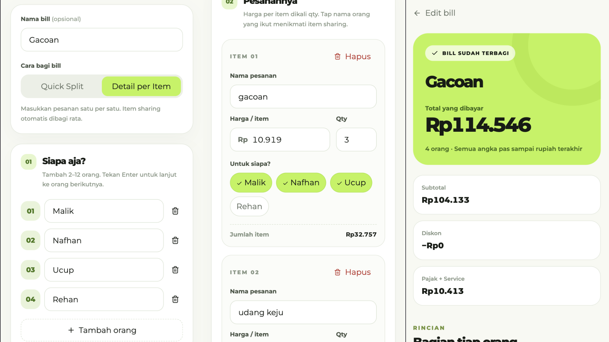
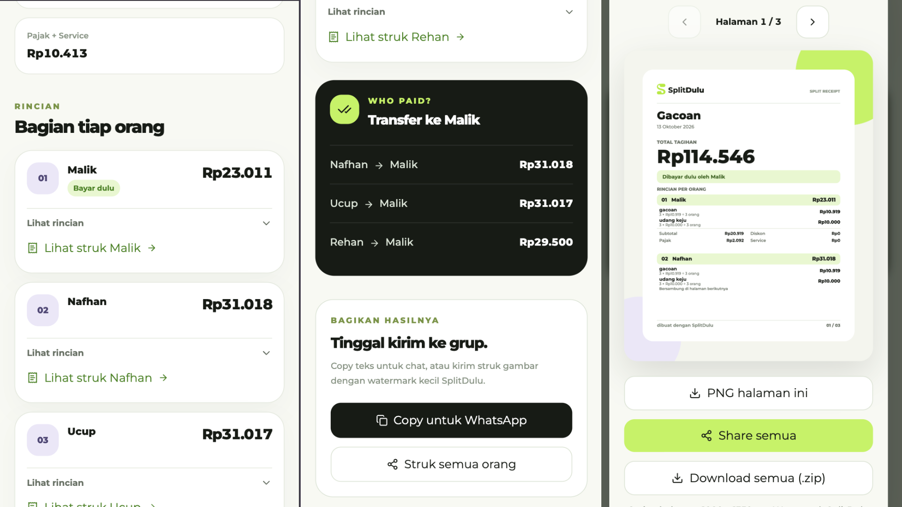

# SplitDulu

**Split the bill, not the conversation.** SplitDulu is a browser-based bill splitter for group meals and other shared bills in Indonesian rupiah (IDR). It calculates each person's share down to the last rupiah and makes the result easy to send. No account or backend is required. The app's interface is in Indonesian.

**[Try SplitDulu](https://splitdulu.vercel.app/)**

## Preview

**Build the bill.** Add participants, assign shared items and quantities, and check the running totals.

[](screenshots/demo-1.png)

**Settle and share.** Review each person's share, see who owes the payer, and export a detailed receipt.

[](screenshots/demo-2.png)

## How it works

1. Add the people sharing the bill. Choose **Quick Split** to enter each person's starting amount, or **Itemized Split** to assign items and quantities to one or more people.
2. Add a discount, tax, and service charge. The totals update as you type. Press **Enter** to advance between fields; use **Tab** for choices and buttons.
3. Select **Who Paid?** to see what everyone else owes the person who paid.
4. Copy a group summary for WhatsApp, or share/download a personal or full-group receipt.

## Features

- **Two ways to split:** use starting amounts for speed, or track individual and shared items with quantities.
- **Balanced calculations:** discounts, tax, and service charges are allocated proportionally. Whole-rupiah rounding keeps the sum of everyone's shares equal to the final total.
- **Bill validation:** Quick Split requires starting amounts to match the subtotal. Both modes validate inputs and keep the calculation balanced, without extra receipt-total checks.
- **Clear settlements:** see each person's breakdown and the amount they should transfer to the payer.
- **Shareable receipts:** export each personal or full-group receipt as one 1080px-wide PNG. Its height grows with the contents, with a scrollable preview and a subtle SplitDulu watermark. No pagination or ZIP needed.
- **Recent bills:** resume up to five bills saved in the same browser.

## Calculation rules

All amounts are in whole rupiah. Shared items are divided equally among the people assigned to them. Discounts are allocated in proportion to each person's pre-discount share. Percentage-based tax and service charges are calculated on the discounted subtotal, then allocated in proportion to each person's post-discount share. Fixed-amount tax and service charges are also supported. Any leftover rupiah from proportional division is assigned deterministically so the breakdown always balances.

## Privacy and storage

Your current draft and recent bills are stored in your browser's `localStorage`, not in an account or bill database. They do not sync between devices and are lost if you clear this site's browser data. Sharing a copied summary or exported receipt is your choice.

## Run locally

Use Node.js 20.9 or newer. No environment variables are required.

```bash
npm ci
npm run dev
```

Open `http://localhost:3000`. If the file watcher reports `EMFILE` on macOS or Linux, try `WATCHPACK_POLLING=true npm run dev`.

## Checks

```bash
npm run lint
npm run typecheck
npm test
npm run build
```

Browser tests cover Enter navigation, legacy drafts, long receipts, PNG downloads, and sharing on desktop Chromium and mobile WebKit:

```bash
npx playwright install chromium webkit
npm run test:e2e
```

Built with Next.js, TypeScript, Tailwind CSS, shadcn/ui, and Lucide icons.

## License and branding

The application source code is available under the [MIT License](LICENSE) © 2026 Malik Nahar. This does not include permission to reuse the SplitDulu name, logo, wordmark, or other visual identity assets, including the vectors in `components/brand.tsx` and `public/favicon.svg`. Please use your own name and visuals for a published fork, or ask for permission first. Third-party dependencies retain their respective licenses.
